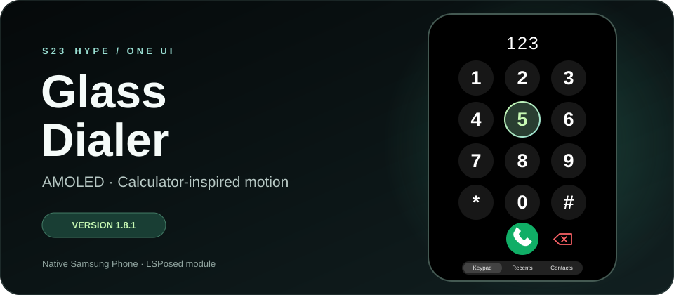

**A cleaner Samsung Phone experience, inspired by Samsung Calculator.**

Made by **[s23_hype](https://t.me/s23_hype)**

---

## The AMOLED edition

Glass Dialer is an LSPosed customization module for Samsung Phone. It retains the native dialer while redesigning its visual experience.

| Feature | Experience |
| :--- | :--- |
| AMOLED | Pure black surfaces in Samsung dark mode |
| Calculator keypad | Large, centered digits with calculator-inspired typography |
| Motion | Green press lighting, recoil and smooth digit-entry transitions |
| Minimal design | No secondary ABC labels or voicemail symbol |
| Backspace | Red icon with native press feedback |
| Navigation | Samsung's native tabs with drag-to-switch support |
| Community | Animated Telegram welcome, activation guide and end-of-Contacts creator credit |

## Download

**[GlassDialer-v1.8.1.apk](https://github.com/muneebranjha10/Keypad/releases/download/v1.8.1/GlassDialer-v1.8.1.apk)** · [Release notes](https://github.com/muneebranjha10/Keypad/releases/tag/v1.8.1)

## Installation

1. Install the APK.
2. Open Glass Dialer to see the welcome screen and setup guide.
3. Open LSPosed Manager → Modules → Glass Dialer.
4. Enable the module and select **Samsung Phone** (`com.samsung.android.dialer`) in its scope.
5. Turn on Samsung Dark mode.
6. Force stop Samsung Phone and reopen it. Reboot if your LSPosed setup requires it.

## Compatibility & safety

Designed around Samsung Phone on One UI 9. Requires a working LSPosed installation and a compatible Samsung Dialer version. Other firmware versions, the latest Contacts footer and sustained 120 Hz rendering are not independently verified. The calculator-inspired effects are recreated, not a proprietary renderer port.

If normal dialing or navigation is affected, disable the module in LSPosed and restart Phone. Verify dialing before relying on the customized app. No SystemUI scope or additional root commands are needed. If updating fails because of a debug signature mismatch, uninstall only the old **Glass Dialer module APK**, reinstall, and re-enable its scope; do not uninstall Samsung Phone.

## Development

Java 17 · Gradle 8.11.1 · Android SDK 35. GitHub Actions compiles and verifies the APK signature and runs pure-Java regression checks. These checks do not replace on-device UI testing.

[Development changelog](CHANGELOG.md) · [Report a bug](https://github.com/muneebranjha10/Keypad/issues) · [Build history](https://github.com/muneebranjha10/Keypad/actions)

---

**Designed for Samsung. Built for a cleaner experience.**

[Telegram — s23_hype](https://t.me/s23_hype)

